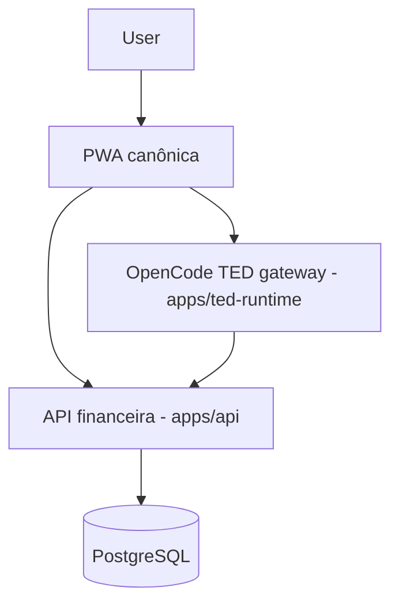

# Meu Ted - Arquitetura atual

**Last verified:** 2026-11-17
**Reference:** [`runtime-facts.json`](architecture/runtime-facts.json)

## Topologia implementada

`apps/ted-runtime` é o único runtime conversacional. O runtime A0 (`apps/agent`) foi descontinuado em 2026-11-17 e removido do repositório ativo, workspaces, build e CI. A aposentadoria de código não remove nem altera recursos ou dados históricos de produção.

## Responsabilidades e limites

- **API (`apps/api`):** fonte única de verdade financeira; autenticação, autorização por workspace, Pending V2, idempotência, confirmação, execução e recibos.
- **PWA (`apps/pwa`):** cliente web/mobile e fronteira same-origin; não recebe autoridade financeira nem atestação.
- **TED runtime (`apps/ted-runtime`):** runtime conversacional OpenCode e gateway privado; usa as ferramentas financeiras apoiadas pelos contratos da API.
- **Contratos (`packages/llm-contracts`):** tipos e schemas compartilhados entre API e runtime. Paridade de catálogo é validada em `apps/ted-runtime/tests/api-contract-parity.test.mjs`.

## Segurança operacional

A API permanece autoritativa para toda escrita financeira. O runtime conversacional não substitui autenticação, autorização, confirmação ou idempotência da API. Deploy e remoção de recursos de produção não fazem parte desta documentação nem desta mudança.
