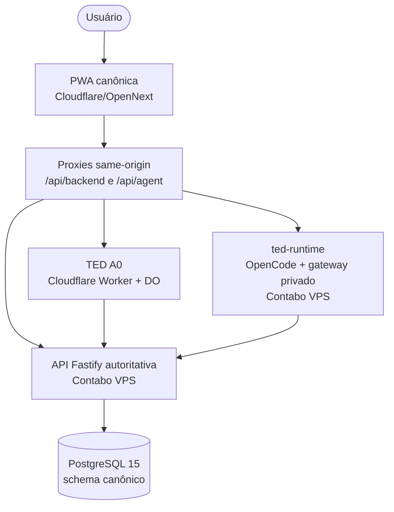

# Meu Ted — Arquitetura atual

**Last verified:** 2026-11-10
**Reference:** [`runtime-facts.json`](architecture/runtime-facts.json)

## Topologia implementada

O runtime conversacional principal é o **OpenCode** (`apps/ted-runtime`). O
A0 (`apps/agent`) permanece ativo como rollback e como emissor autorizado de
propostas Pending V2. A seleção é persistida por conversa no cookie
`ted-runtime-conversation`: sentinela `agent` = A0; `opencode.<uuid>` = B. O
kill switch `TED_OPENCODE_RUNTIME_KILL_SWITCH=1` devolve até conversas com pin
`opencode.*` ao A0 e expira o pin; operações pendentes vivem na API, então a
troca de runtime não duplica nem perde nada.

## Responsabilidades e limites

- **API (`apps/api`):** única fonte da verdade financeira. Autentica,
  autoriza por workspace e aplica idempotência. Pending operations V2 são
  armazenadas e transitam aqui, vinculadas a `workspaceId`, `actorId` e
  `deviceId`; confirmação, execução, cancelamento, retry e expiração são
  rotas autoritativas com capability delegada específica.
- **PWA (`apps/pwa`):** aplica sessão e CSRF nos proxies same-origin. A
  autenticação online é session-first e cookie-only. `proxy-utils.ts`
  classifica o pin e seleciona A0/B; apenas `chat`, `history` e
  `session/new` vão para o OpenCode. A UX do TED envia apenas uma decisão e
  um `requestId`; nunca envia/recebe atestação.
- **OpenCode runtime (`apps/ted-runtime`):** SDK 2.2.4 nativo para sessão,
  transcript, seleção de modelo e plugins. O gateway privado resolve
  identidade server-side via `POST /auth/agent-token` + `GET /auth/devices/me`
  e mantém bindings host-bound. As tools financeiras chamam a API com
  `x-device-token`/`x-workspace-id`; o transporte aceita apenas loopback ou a
  origem interna exata listada em `TED_API_ALLOWED_ORIGINS`. Escritas são
  somente **intenções**: o runtime nunca emite capability, confirma ou executa.
- **A0 (`apps/agent`):** orquestração e memória conversacional de rollback. O
  broker `POST /rpc/pending-operations/propose` é o único emissor de
  `financial.approval.propose` para intenções vindas do OpenCode; o
  `MutationExecutor` continua sendo o único cliente do ciclo de decisão V2 e
  o único consumidor/emissor de atestação. O provider/modelo não concede
  capability, aprovação ou write.
- **Contratos (`packages/llm-contracts`):** schemas e tipos compartilhados
  entre API, A0 e testes de contrato.

## Autorização de mutações

A confirmação humana é condicional, não universal. A policy determinística da
API pode autoautorizar somente `transactions.expense.create` e
`transactions.income.create` de baixo risco; o limiar de R$ 500 exige
confirmação e operações destrutivas/incertas ficam sempre manuais.
PendingOperation V2, idempotência e receipt permanecem inalterados.
`TED_RISK_BASED_AUTOEXECUTE` aceita `off|shadow|on`, default `off`; kill
switch = definir `off`. O modelo não concede autorização. Consulte
[ADR-026](adr/ADR-026-risk-based-mutation-authorization.md) e
[observabilidade](ops/ted-autoexecute-observability.md).

## Segurança operacional

- O gateway OpenCode escuta loopback por padrão; bind não-loopback exige
  `TED_GATEWAY_ALLOW_NON_LOOPBACK=1` e a origem interna exata em
  `TED_API_ALLOWED_ORIGINS`. Nenhuma interface administrativa é exposta.
- O sistema falha fechado se falta esquema, evidência, binding, capability,
  autorização técnica, receipt ou autoridade do provider.
- O runtime não segue redirects com o token do dispositivo e não transporta
  credenciais para origens não listadas.
- A API web inicializa em modo verify-only. Migrations são executadas somente
  pelo job explícito documentado em `docs/runbooks/api-migration-v2.md`.

## Legado e estado de implantação

O `WorkspaceAgent` foi removido na V4 (ver
`docs/adr/ADR-016-workspace-agent-decommissioning.md`). O WhatsApp Bridge e a
extensão Pi foram removidos dos workspaces, CI e runtime ativo. O
`apps/codex-broker` foi removido em 2026-11-10: não tinha configuração de
deploy/secret e seu adapter falhava fechado por ausência de runtime real. O
cliente opcional `private-broker-client` do A0 permanece inerte sem
`CODEX_BROKER_ORIGIN` e signing key.

Produção: OpenCode (`ted-runtime`) e API/PostgreSQL na VPS Contabo atrás do
Traefik; PWA e A0 do Agent na Cloudflare. O estado vivo de produção (SHAs,
flags e ledger) é registrado apenas em
[`MEU-TED-V1-FINAL-STATE.md`](MEU-TED-V1-FINAL-STATE.md) a partir de evidência
autorizada; fatos de código derivam de
[`runtime-facts.json`](architecture/runtime-facts.json).

## Dados e esquema

- A API de produção serve o esquema canônico (`DB_SCHEMA=canonical`, banco
  `pi_financeiro_canonical`); o banco legacy (`pi_financeiro`) permanece como
  archive intocado.
- O uso de bearer legado é registrado em sink durável em `audit_logs`
  (`auth.request.legacy_bearer_used`); a janela e o flip permanecem gate
  humano documentado em [`ROADMAP.md`](ROADMAP.md).
