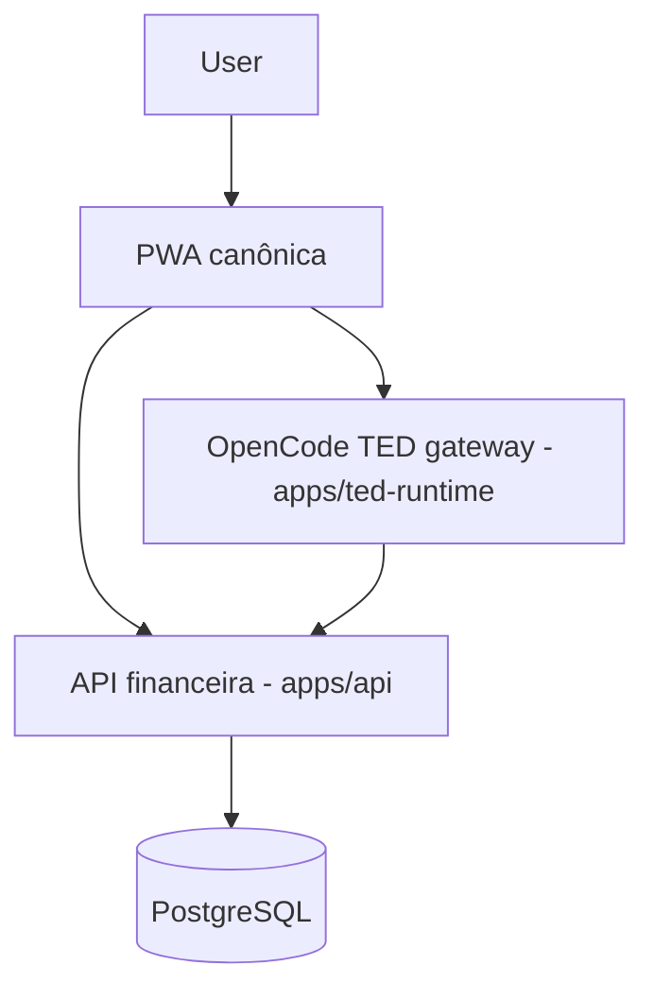

# Meu Ted - Arquitetura atual

**Last verified:** 2026-11-19 (topologia e evidências de produção); fluxo TED revisitado em 2026-11-21 (branch `feat/ted-remocao-completa-aprovacao`, sem deploy).
**Reference:** [`runtime-facts.json`](architecture/runtime-facts.json)

## Topologia implementada

`apps/ted-runtime` é o único runtime conversacional. O runtime A0 (`apps/agent`) foi descontinuado em 2026-11-17 e removido do repositório ativo, workspaces, build e CI. A aposentadoria de código não remove nem altera recursos ou dados históricos de produção.

Em produção, o Worker A0 foi removido; o gateway é o runtime único. R2/DO foram preservados.

**Estado efetivo V2.1 (2026-11-19):** `TED_OPENCODE_CATEGORY_AUTOEXEC_ENABLED=1`
no gateway (autorizado pelo operador em 2026-11-19; compose interpola a variável
com default `1`), `TED_RISK_BASED_AUTOEXECUTE=on` na API (preexistente) e
autocreate de categoria/supersede Pending V2 habilitados na API. A autoexecução
de `categories.create` está ativa apenas para essa operação. PRs **#455–#459**
integrados; **P5 PASS** e **Jornada C PASS 4/4** em **ambiente sintético com LLM
real**. **Registro histórico do fluxo com aprovação — smoke autenticado em produção (2026-11-20, Test Family): PASS** — login, conta, transação, extrato, TED lendo dado real e mutação por proposta com recibo único (`live-mobile-full`, 0 violações de workspace); `categories.create` por autoexec confirmado a partir do 2º turno da conversa (sem card; categoria lida como ativa pelo TED). **Memória de categoria validada em produção (2026-11-20, Test Family):** correção Lanche→Padaria aprendida e aplicada em conversa nova (gateway `bab19db`, PRs #463–#466). Preferência genérica não é persistida por desenho.

**HISTÓRICO (2026-11-18):** `TED_OPENCODE_CATEGORY_AUTOEXEC_ENABLED=0` no
gateway; sem cliente de autoexecução, `categories.create` autoexec não estava
ativa. Registro mantido apenas como histórico; não reflete o estado atual.

**Estado vigente no branch (2026-11-21, sem deploy):** o conceito de aprovação foi removido. As 14 tools `propose_*` viraram tools de ação (`record_expense`, `record_income`, `record_card_purchase`, `transfer_between_accounts`, `pay_card_statement`, `create_account`, `create_category`, `update_transaction`, `rename_account`, `deactivate_account`, `rename_category`, `deactivate_category`, `create_payable`, `pay_payable`); `undo_last_action` permanece. Não há `TED_AGENT_SELF_CONFIRM`, card Confirmar/Cancelar nem autoexecução de categoria no runtime: o gateway executa a ação no mesmo turno quando a declaração de completude da tool é favorável e a API valida a apresentação; dado faltante, ambiguidade, 409 `approval.not_actionable` ou erro viram pergunta em texto, sem card e sem sucesso falso. O [Pending V2](adr/ADR-010-pending-operation-v2.md) segue apenas como motor interno server-side de execução, auditoria e idempotência; a API é a única autoridade. Ver [ADR-034](adr/ADR-034-agente-executa-sem-aprovacao.md) (supersede o [ADR-033](adr/ADR-033-agente-confirma-pending-v2.md)). Rollback: redeploy da imagem `ted-runtime:rollback-pre-<sha>`.

## Responsabilidades e limites

- **API (`apps/api`):** fonte única de verdade financeira; autenticação, autorização por workspace, Pending V2, idempotência, confirmação, execução e recibos.
- **PWA (`apps/pwa`):** cliente web/mobile e fronteira same-origin; não recebe autoridade financeira nem atestação.
- **TED runtime (`apps/ted-runtime`):** runtime conversacional OpenCode e gateway privado; usa as ferramentas financeiras apoiadas pelos contratos da API.
- **Contratos (`packages/llm-contracts`):** tipos e schemas compartilhados entre API e runtime. Paridade de catálogo é validada em `apps/ted-runtime/tests/api-contract-parity.test.mjs`.

## Segurança operacional

A API permanece autoritativa para toda escrita financeira. O runtime conversacional não substitui autenticação, autorização, idempotência ou o pipeline interno de execução/auditoria da API; a confirmação pelo usuário deixou de existir como superfície ([ADR-034](adr/ADR-034-agente-executa-sem-aprovacao.md)), restando o `undo` como rede de segurança. Deploy e remoção de recursos de produção não fazem parte desta documentação nem desta mudança.
