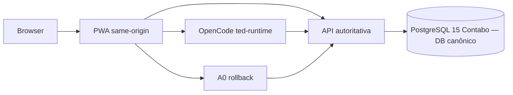

# Meu Ted — Arquitetura alvo

**Last verified:** 2026-11-13
**Reference:** [`runtime-facts.json`](architecture/runtime-facts.json)

## Estado alvo consolidado

A superfície é composta por PWA, API autoritativa e dois runtimes
conversacionais com papéis explícitos: **OpenCode** (`apps/ted-runtime`) como
cérebro principal e **A0** (`apps/agent`) como rollback funcional e emissor
autorizado de propostas. O browser fala apenas com a origem da PWA; a API na
VPS segue como única autoridade financeira e o PostgreSQL é a persistência de
produção. Não há runtime WhatsApp/Bridge nem extensão Pi como caminho
operacional.

## Propriedades de convergência

1. O OpenCode usa sessões, transcript, modelo e plugins nativos. O produto
   mantém apenas o gateway autenticado, o binding de identidade, o transporte
   financeiro host-bound e a projeção de intenção de proposta.
2. O A0 permanece atrás do mesmo contrato Pending V2 e do mesmo broker, sem
   criar um segundo caminho de autorização. A seleção de runtime é por
   conversa e o rollback é imediato (`TED_OPENCODE_RUNTIME_KILL_SWITCH=1`).
3. Respostas financeiras usam evidência atual da API; memória só fornece
   contexto não autoritativo.
4. Provedores são adaptadores de texto/ferramenta e nunca são fonte de
   identidade, capability, aprovação ou valor financeiro.
5. Toda mutação passa por PendingOperation V2 e execução idempotente na API.
   Confirmação humana é condicional: a policy autoriza apenas a allowlist
   `transactions.{expense,income}.create` de baixo risco; R$ 500 ou mais e
   operações destrutivas/incertas permanecem manuais. Receipt e autoridade
   canônica da API não mudam.
6. CI executa API, Agent, runtime OpenCode, PWA, Postgres descartável,
   containers, segurança, documentação e invariantes arquiteturais. Deploys
   PWA/Agent só são elegíveis após conclusão `success` do workflow `CI` no SHA
   aprovado.

## Estado de rollout

Canário restrito a dois workspaces (`d36cb649-4462-486d-940a-47128ad329f2` e
`550e8400-e29b-41d4-a716-446655440000`); apenas `chat`, `history` e
`session/new` vão para o OpenCode; pending/undo/attachments permanecem no A0.
A0 permanece como rollback funcional e emissor autorizado de propostas Pending
V2. Kill switch `TED_OPENCODE_RUNTIME_KILL_SWITCH=1` devolve toda conversa ao
A0, inclusive pins `opencode.*`. WhatsApp está fora de escopo por ora; o Bridge
foi removido e não será reconstruído.

## Rollout e rollback

O rollout começa por fixtures e CI, seguido de leituras, propostas e
confirmação. O kill switch da PWA devolve toda conversa ao A0, inclusive as
com pin `opencode.*`, e expira o pin; parar o container `ted-runtime` mantém o
A0 atendendo. Nenhum rollback altera lançamentos, restaura ledger antigo ou
reintroduz `[EXEC_ACTION]`, atestação no browser ou write sem confirmação.
