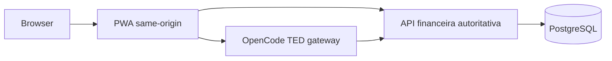

# Meu Ted - Arquitetura alvo

**Last verified:** 2026-11-17
**Reference:** [`runtime-facts.json`](architecture/runtime-facts.json)

## Topologia

O gateway OpenCode em `apps/ted-runtime` é o único runtime conversacional. O A0 (`apps/agent`) foi descontinuado nesta data; não há fallback conversacional para ele. Esta decisão de código não implica exclusão de dados históricos ou remoção de recursos em produção.

## Invariantes

1. A API (`apps/api`) é a única autoridade para identidade, autorização por workspace, Pending V2, idempotência e estado financeiro.
2. O runtime TED encaminha intenções e consultas por contratos suportados; confirmação e execução permanecem na API.
3. PWA, gateway e API preservam seus limites de autenticação e transporte.
4. Testes de API e `apps/ted-runtime/tests/api-contract-parity.test.mjs` validam os contratos e a paridade de catálogo mantidos.
5. CI conserva gates de API, PWA, ted-runtime, Postgres, documentação, segurança e governança; não há job de build/test/deploy do A0.

Deploy de produção e remoção de recursos Cloudflare não fazem parte desta mudança.
