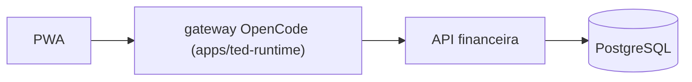

# Missão - TED OpenCode-only

**Diretriz central:** retirar o A0 de todas as rotas sem mover autoridade financeira, confirmação ou atestação para fora da API.

## Arquitetura alvo

A API permanece autoridade única para auth, autorização por workspace, Pending V2, idempotência, recibos e atestação.

## Marcos

| Marco | Estado | Critério verificável |
|---|---|---|
| 1. Token delegado | CONCLUÍDO | `POST /auth/agent/pending-token`; integração gateway/API em `apps/api/tests/integration/ted-runtime-pending-lifecycle.test.ts` (7/7). |
| 2. Pending, undo e atestação | CONCLUÍDO | Rotas do gateway documentadas em `VALIDATION.md`; ciclo Pending V2 integrado passa 7/7. |
| 3. Roteamento PWA | CONCLUÍDO | Proxy gateway-only e `x-ted-runtime: opencode`; typecheck/lint sem erros. |
| 4. Inteligência financeira | PARCIAL | Piloto real de leitura passou; proposta+confirmação pendente por falhas de harness. |
| 5. Remoções funcionais | CONCLUÍDO | Live-sync, anexos/microfone e admin LLM removidos da PWA. |
| 6. Corte total | CONCLUÍDO | Proxy sem pin/kill switch/allowlist/fallback A0; apps A0 removidos. |
| 7. Remoção do A0 | CONCLUÍDO | `apps/agent` e `apps/codex-broker` removidos; lockfile sem importer A0. |
| Recursos de produção | PENDENTE | Nada foi deployado nem removido do Cloudflare; requer autorização e inventário próprios. |

## Marco 2 - inteligência financeira

Estado: PARCIAL. Piloto real de leitura passou. Piloto de proposta+confirmação não concluiu devido a falhas do harness; a confirmação real permanece pendente. O ciclo está provado deterministicamente pelo teste de integração 7/7.

**Critério:** piloto real de proposta+confirmação; ainda pendente.

## Critérios de conclusão

| Critério | Evidência esperada |
|---|---|
| Chat `/rpc/chat`, `/rpc/history`, `/rpc/session/new` migrado | Testes de rotas e canário por cookie/flags. |
| Proposta Pending V2 via gateway com token delegado | Teste de emissão/uso de token e preservação da idempotency key sha256(`workspace:intentionId:tool`). |
| Active e decisão migrados sem alterar autoridade | Testes de passthrough, `presentation` server-derived e confirm→authorize/execute→outcome na API. |
| Undo migrado; verify-target não recriado | Testes de store mínimo e `POST /pending-operations/undo`; busca confirma ausência de consumidor recriado. |
| Atestação de workspace migrada | Teste da prova HMAC canônica e depósito em `/internal/agent/empty-attestations`; delete permanece na API. |
| Inteligência financeira funcional | Evidência das jornadas com modelo real e sem respostas simuladas. |
| Remoções funcionais e operacionais concluídas | Busca de consumidores/rotas e gates demonstrando ausência de live-sync, anexos, memória/prefs e A0. |
| Integridade financeira preservada | Testes de auth, workspace, Pending V2, idempotência, recibos e atestação. |
| Corte validado em 12 cenários | Relatório E2E com os 12 cenários aprovados. |

## Não-objetivos e autorização

- Não portar `MutationExecutor`, orquestrador, decision layer, drafts, user-skills, web search, migration/legacy-history ou prompt estruturado.
- Não apagar dados históricos A0 (DO SQLite/R2) nesta migração.
- Deploy exige autorização explícita. Remoção de recursos Cloudflare em produção exige autorização específica.
- Apagar binding R2 exige confirmação de operador.
- Custos de inferência exigem decisão/autorização humana.

## Sequência e inventário

Ver [`MIGRATION-SEQUENCE.md`](MIGRATION-SEQUENCE.md), [`INVENTORY.md`](INVENTORY.md) e [`VALIDATION.md`](VALIDATION.md) para evidências e pendências.
